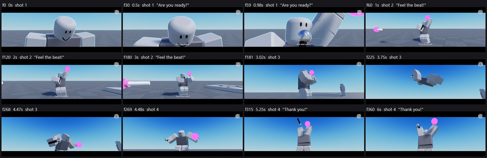
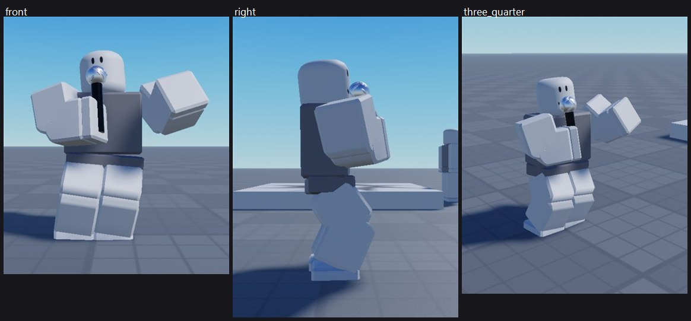
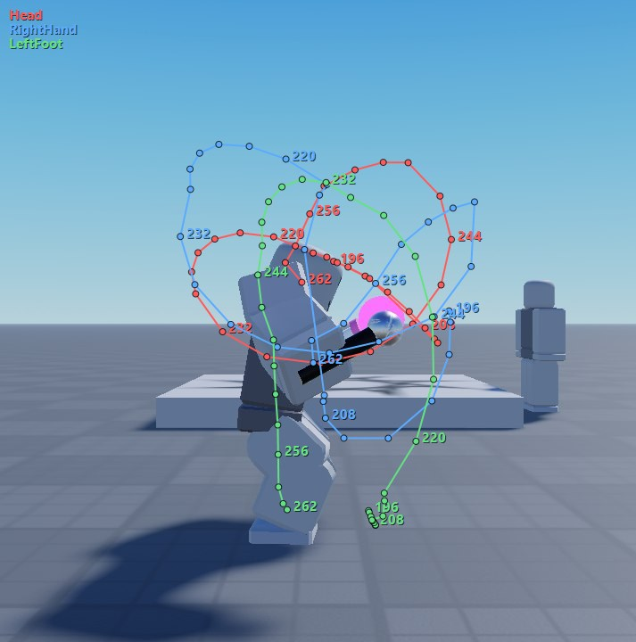
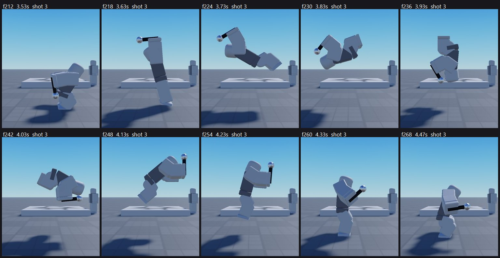

# moon-animator-mcp

An unofficial [Model Context Protocol](https://modelcontextprotocol.io) server
that lets an AI agent see, measure and author
[Moon Animator 2](https://create.roblox.com/store/asset/4725618216) animations
and cutscenes inside Roblox Studio.

The agent works in the same Moon Animator file you do: it looks at the
viewport through the cutscene camera, previews poses before committing them,
writes keyframes with undo, and exports with Moon Animator's own exporter.



> **Moon Animator 2 is required and is not included.** It is a separate product
> by its own author. Every user installs it from the Roblox Creator Store. This
> project does not contain, modify or redistribute any Moon Animator code, and
> is not affiliated with or endorsed by its author or by Roblox.

## What the agent can do

| See | Measure | Author |
| --- | --- | --- |
| Storyboards of a whole cutscene, picked per camera shot | Part positions over time, in world space or relative to another part | Keyframes on rig joints, the camera and any property, one undo step per call |
| Screenshots at any frame, through the cutscene camera or auto-framed on a rig | Foot sliding while planted, jump height, hand-to-face distance | Large rotations (flips, pirouettes, prop twirls) that turn the intended way |
| Pose previews from several sides without writing keyframes | Camera shots: cuts, moves, distances, lens | Rigs, props welded to a hand, camera, subtitles, letterbox |
| Motion trails that show timing, spacing and arcs | Inverse kinematics: joint angles that put a hand or prop on a target | Save, undo, redo, export to KeyframeSequence |

| Pose preview | Motion trail |
| --- | --- |
|  |  |



## Requirements

- Windows 10 or 11 (screen capture and the Studio plugin installer are Windows-only)
- [Roblox Studio](https://create.roblox.com/)
- **Moon Animator 2, installed from the [Roblox Creator Store](https://create.roblox.com/store/asset/4725618216)**
- [Node.js](https://nodejs.org/) 20 or newer, and [Git](https://git-scm.com/) (npx installs this package from GitHub)
- An MCP client. The steps below use [Claude Code](https://claude.com/claude-code); any client that runs stdio servers works.

## Install

There are two halves, and both are needed in every setup:

1. **The Studio side**: a small Studio plugin named MoonBridge, which connects
   Studio to the server on your machine.
2. **The agent side**: the MCP server, in one of three forms.

### Step 1: install the MoonBridge Studio plugin

```powershell
npx -y github:DeepTutorAi/moon-animator-mcp install-plugin
```

Then restart Roblox Studio and open a place. The first time, Studio asks
whether MoonBridge may make HTTP requests to `127.0.0.1`: allow it. Open Moon
Animator 2 from the Plugins tab as usual.

The installer writes `MoonBridge.rbxmx` into `%LOCALAPPDATA%\Roblox\Plugins`
with a secret token generated on your machine (see [Security](#security)).

### Step 2: choose how the agent gets the tools

#### Option A: MCP server only

```powershell
claude mcp add --scope user moon-animator -- npx -y github:DeepTutorAi/moon-animator-mcp
```

For other clients, the equivalent configuration is:

```json
{
  "mcpServers": {
    "moon-animator": {
      "command": "npx",
      "args": ["-y", "github:DeepTutorAi/moon-animator-mcp"]
    }
  }
}
```

#### Option B: MCP server plus the agent skill

The skill is an optional field guide for the agent: the order to work in, how
joint angles behave, how to get a prop to the mouth, how to cut a camera, and
tested recipes. It makes a noticeable difference to the first result.

Do Option A, then:

```powershell
npx -y github:DeepTutorAi/moon-animator-mcp install-skill
```

This copies the skill to `~/.claude/skills/moon-animator`. Use `--project` to
install into the current project's `.claude/skills` instead, or
`--dir <folder>` for another client's skills folder.

#### Option C: Claude Code plugin (server and skill together)

```powershell
claude plugin marketplace add DeepTutorAi/moon-animator-mcp
```

```powershell
claude plugin install moon-animator@moon-animator-mcp
```

On Claude Code 2.1.275 or later the same thing is one step inside a session:

```
/plugin install moon-animator --marketplace DeepTutorAi/moon-animator-mcp
```

The plugin starts the same server through npx and bundles the same skill. Do
not combine it with Option A, or the tools will be listed twice.

### Step 3: check

Ask the agent to call `moon_status`, or run:

```powershell
npx -y github:DeepTutorAi/moon-animator-mcp doctor
```

`moon_status` reports whether the Studio plugin is connected, whether Moon
Animator 2 is loaded, and which file is open, and says what to do about
anything missing.

## Using it

With Studio open and Moon Animator showing, ask for what you want:

- "Show me a storyboard of the open cutscene and tell me which shot is weakest."
- "Add an R15 rig named Dancer, give it a microphone in the right hand, and animate a two-second singing pose."
- "The feet slide during the groove between frames 60 and 180. Measure it and fix it."
- "Add a backflip at frame 218, then show me the motion trail of the head."
- "Export the animation."

Everything the agent does lands in your Moon Animator file, and each edit is
one step in Moon Animator's undo history.

## Tools

| Tool | Purpose |
| --- | --- |
| `moon_status` | Connection, Moon Animator state, open file. Call first. |
| `moon_scene` | Items, tracks, keyframes and easing of the open file. |
| `moon_screenshot` | Viewport image at a frame, from the cutscene camera, a custom camera, or auto-framed on an item. |
| `moon_storyboard` | Contact sheet of frames, picked per camera shot or given explicitly. |
| `moon_camera_path` | Shot list: cuts, movement type, distances, lens. |
| `moon_preview_pose` | Images and measurements of a pose without creating keyframes. |
| `moon_motion_trail` | Paths of parts over time with speed, peaks and holds. |
| `moon_sample` | Part positions per frame and a foot-sliding report. |
| `moon_solve_reach` | Joint rotations that bring a part to a target. |
| `moon_open_file` | Open or create a Moon Animator file. |
| `moon_save` | Save the open file. |
| `moon_settings` | Timeline length, loop, export priority. |
| `moon_undo` | Undo or redo Moon Animator actions. |
| `moon_insert_rig` | Place a built-in character rig. |
| `moon_attach_prop` | Weld a prop to a rig part as an animatable joint. |
| `moon_add_items` | Add rigs, the camera, subtitles and effects to the file. |
| `moon_set_keyframes` | Add or update keyframes on joints and properties. |
| `moon_spin` | Key a rotation of any size, with an optional jump arc. |
| `moon_delete_keyframes` | Delete keyframes or clear a track. |
| `moon_export` | Export with Moon Animator's exporter and verify the result. |

## How it works

```
MCP client  ──stdio──  moon-animator-mcp  ──HTTP on 127.0.0.1──  MoonBridge plugin  ──  Moon Animator 2
                             │                                     (Roblox Studio)
                             └── window capture (viewport only)
```

- The MoonBridge plugin long-polls the server on `127.0.0.1` and runs the Luau
  snippets it sends. Those snippets call the same functions Moon Animator's own
  interface calls, so edits behave exactly like edits made by hand.
- Images are taken from the Studio window and cropped to the 3D viewport. The
  Moon Animator window is hidden for the moment of capture and then restored,
  along with the timeline position and camera.
- If several agent sessions run at once, the first server hosts the bridge and
  the others relay through it.

## Security

- The bridge listens on `127.0.0.1` only and every request needs a secret
  token. The token is generated on first use and stored in
  `~/.moon-animator-mcp/bridge-token`; the installer embeds the same value in
  your copy of the Studio plugin.
- The Studio plugin executes Luau sent by the local server. Any program on your
  machine that can read the token file can therefore run code in your Studio
  session. Do not share the token or your installed `MoonBridge.rbxmx`.
- A tool that runs arbitrary Luau (`moon_exec_luau`) exists for development
  and is disabled unless `MOON_MCP_ALLOW_EXEC=1` is set.

## Configuration

| Variable | Default | Purpose |
| --- | --- | --- |
| `MOON_BRIDGE_PORT` | `47823` | Bridge port. Set it for both `install-plugin` and the server; reinstall the plugin after changing it. |
| `MOON_MCP_HOME` | `~/.moon-animator-mcp` | Where the token is stored. |
| `MOON_MCP_ALLOW_EXEC` | unset | `1` enables `moon_exec_luau`. |

## Limitations

- Windows only.
- Tested with Moon Animator 2 version 36000. The server uses Moon Animator's
  internal functions, which are not a public API; a Moon Animator update can
  break tools until this project catches up. `moon_status` warns when the
  installed version differs from the tested one.
- Studio must be in edit mode, with its window not minimized while images are
  captured (a minimized window is restored automatically).
- One Studio instance at a time.
- Publishing an exported KeyframeSequence to Roblox is left to you.

## Updating and uninstalling

npx caches the package. To pick up a new version, clear the cache, then
reinstall the Studio plugin if the release notes say it changed:

```powershell
npx clear-npx-cache
```

To remove everything:

```powershell
npx -y github:DeepTutorAi/moon-animator-mcp uninstall-plugin
```

```powershell
claude mcp remove moon-animator
```

Then delete `~/.moon-animator-mcp` and, if installed, the
`~/.claude/skills/moon-animator` folder. For Option C use
`claude plugin uninstall moon-animator@moon-animator-mcp`.

## Troubleshooting

| Symptom | Fix |
| --- | --- |
| `moon_status` says the plugin is not connected | Studio is closed, the plugin is not installed, or the HTTP prompt was declined. In Studio: Plugins tab → Manage Plugins → MoonBridge → allow HTTP requests to `127.0.0.1`. |
| `moon_status` says Moon Animator 2 is not loaded | Install it from the Creator Store, then open it from the Plugins tab. |
| The server does not start in your MCP client | Run `npx -y github:DeepTutorAi/moon-animator-mcp --version` in a terminal to see the error. Git and Node.js 20+ must be on `PATH`. |
| Images are black or show the wrong area | Leave the Studio window open and unminimized; ask the agent to capture again with `recalibrate`. |

## Development

```powershell
git clone https://github.com/DeepTutorAi/moon-animator-mcp
```

```powershell
npm test
```

There are no runtime dependencies. One test file runs the Studio plugin under
the standalone [Luau](https://luau.org) CLI and is skipped when Luau is not
installed (set `MOON_LUAU` to its path). `tools/mcp-call.mjs` calls a single
tool over real MCP stdio, which is handy for trying changes against Studio:

```powershell
node tools/mcp-call.mjs moon_storyboard "{}" --save storyboard.jpg
```

## License

[MIT](LICENSE). Moon Animator 2 is the property of its author and is licensed
separately; buy it from the Creator Store to use this project and to support
its development.
